# Edge Desk

**A paper-trading desk that prices Bitcoin and Ether event contracts on Kalshi and Polymarket from the Deribit options market, trades only when the gap beats fees and model error, and is built like a production trading system: event-sourced, deterministic, risk-checked and measured.**

> Paper trading only. No real orders, no accounts, no API keys, no wallet: every number comes from public market data. Not investment advice.

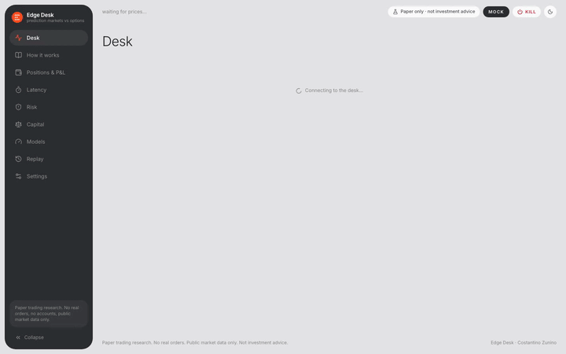

[Watch the full demo (MP4)](docs/media/demo.mp4). The recording runs on the seeded synthetic market so it is reproducible; the results below are from recorded live data.

**The honest answer, from 6 hours of recorded live data plus a week of history:** the prediction markets mostly win. On a week of Kalshi hourly Bitcoin and Ether brackets (2,802 markets, 327 expiries), Kalshi's own price was better calibrated than every volatility model I tried, at every horizon from 45 to 5 minutes, and simple "trade the gap" rules lost 2-4 cents per contract after fees (95% intervals exclude zero). On the live recording, the default paper strategy made 293 trades and lost **$645 after fees** (-14% on capital used). Speed is not what is missing: adding up to 5 seconds of latency barely changes the result. The infrastructure is the part that works: every replay is bit-for-bit identical, 473 reconciliations were clean, and the daily loss limit halted trading on its own.

| | |
|---|---|
| Live recording | Nov 7, 2026, 14:21-20:13 UTC: 199k messages, 2,109 contracts, 1,659 resolved (Kalshi 1,457, Polymarket 202) |
| Paper P&L, default config (not tuned) | 293 trades, **-$645 after $128 fees**; Kalshi -$711 (266 trades), Polymarket +$66 (27 trades) |
| Calibration (Brier, lower is better) | Kalshi: market mid **0.068** vs models 0.074-0.076. Polymarket: models 0.011-0.012 vs mid 0.013 |
| Week of history (Kalshi hourly) | mid 0.103 vs DVOL 0.115, realized 0.107; threshold rules -2.4 to -4.3c per contract after fees |
| Latency (p50 / p99 round trip) | Coinbase 31 / 141 ms, Deribit 47 / 111 ms, Polymarket 81 / 156 ms, Kalshi 137 / 408 ms, Binance 232 / 305 ms |
| Internal hot path (p50 per message) | guard 2.8 µs, model 17 µs, signal 5 µs, risk checks 27 µs, order 10 µs |
| Reliability | deterministic replay (same SHA-256 digest twice), 473 / 473 reconciliations clean, 566 bad messages rejected, 1 automatic halt |


## Why it matters

Prediction markets now list a contract on Bitcoin's price for every hour of the day: "Will BTC be above $76,000 at 5 PM ET?". The same question is already priced, continuously and for free, by the Deribit options market. If the two disagree by more than costs, one of them is wrong, and a desk that can tell which, fast and safely, has an edge.

Finding the gap is the easy half. The hard half is the one that loses money in practice: stale quotes, fees that eat a 2-cent edge, a fill that arrives a second late against a book that moved, a feed that silently drops, a position that does not reconcile. This project is mostly about that half. The question I set out to answer honestly is: **after fees, latency and model error, is there anything left?**

## See it in action

| | |
|---|---|
| 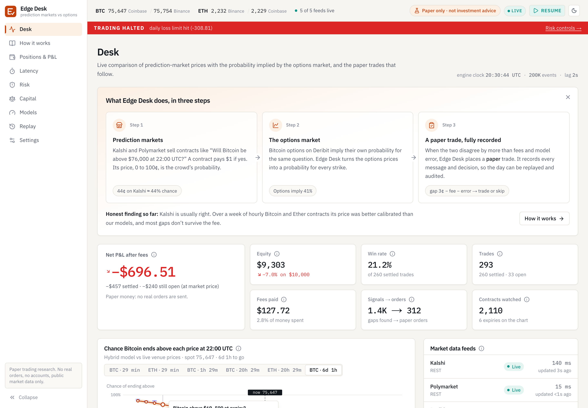 **Desk**: a three-step explainer, the paper P&L, and the hero chart: for one expiry, the model's chance that Bitcoin ends above each strike (with its error band) against what Kalshi and Polymarket charge. Live trade signals are highlighted. | 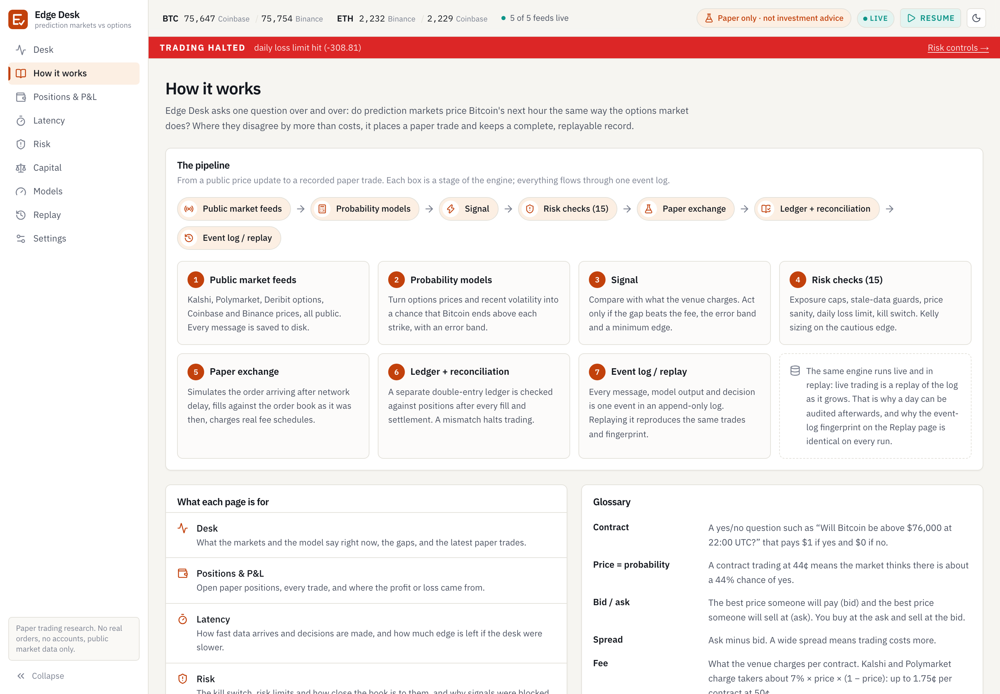 **How it works**: the pipeline from public feeds to the paper ledger, what each page is for, and a glossary. |
| 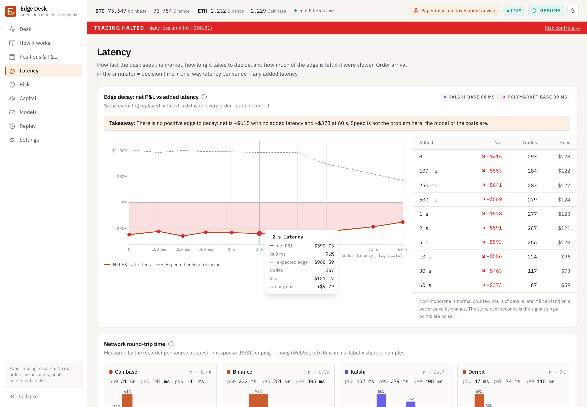 **Latency**: measured round trips per venue, feed lag, per-hop CPU time, and the edge-decay curve (P&L vs added delay). | 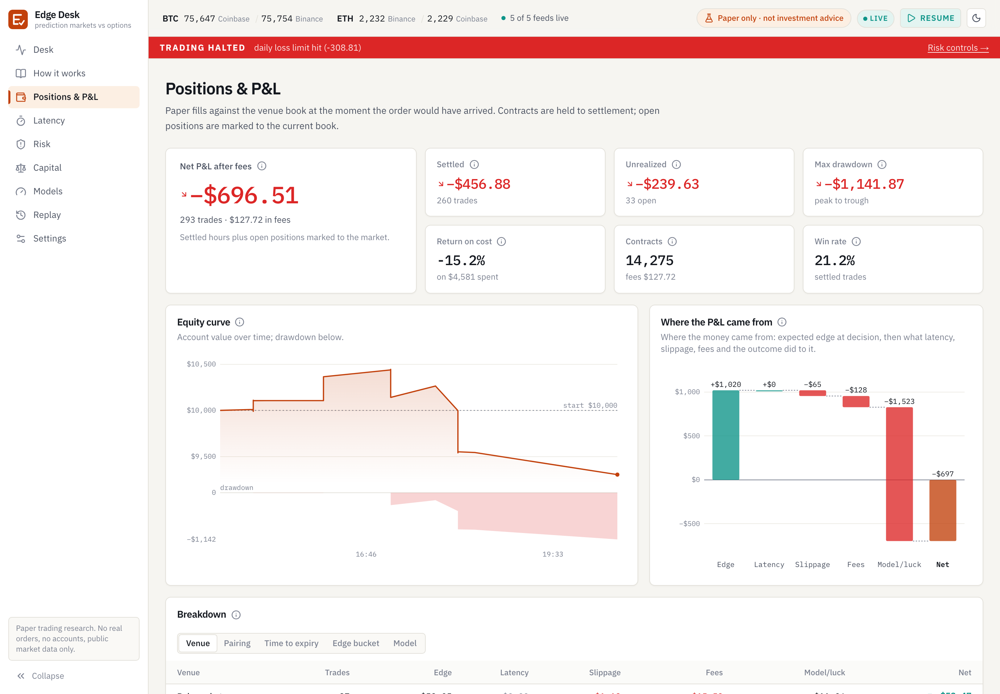 **Positions & P&L**: equity and drawdown, and every trade split into model edge, latency, slippage, fees and outcome. |
| 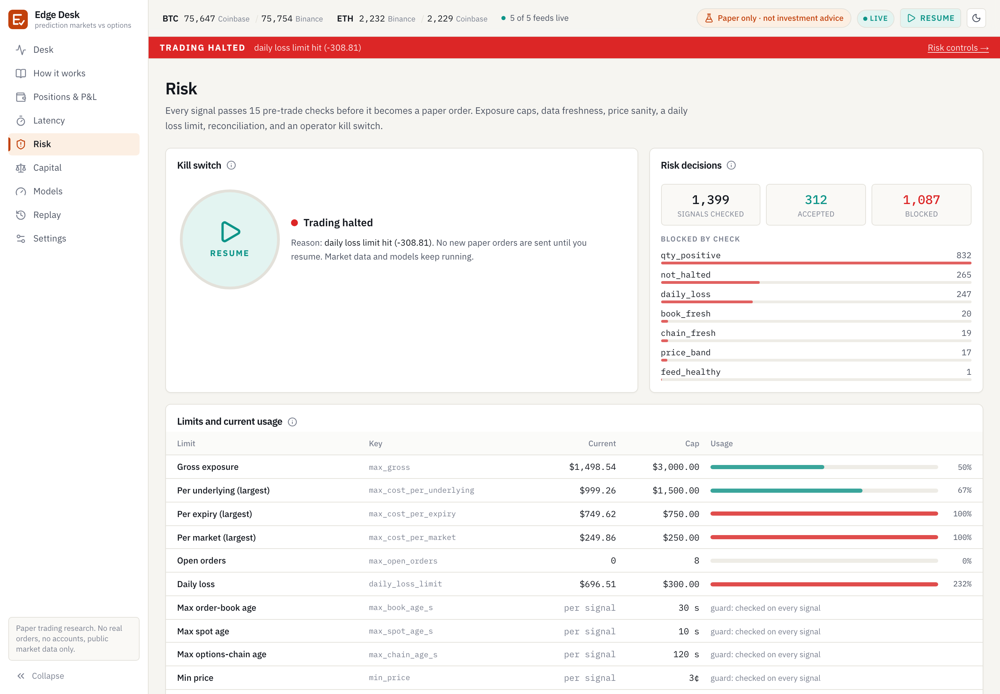 **Risk**, as captured: trading halted by the daily loss limit on its own, with the resume control, limits and live usage, which checks blocked orders, reconciliation and feed health. | 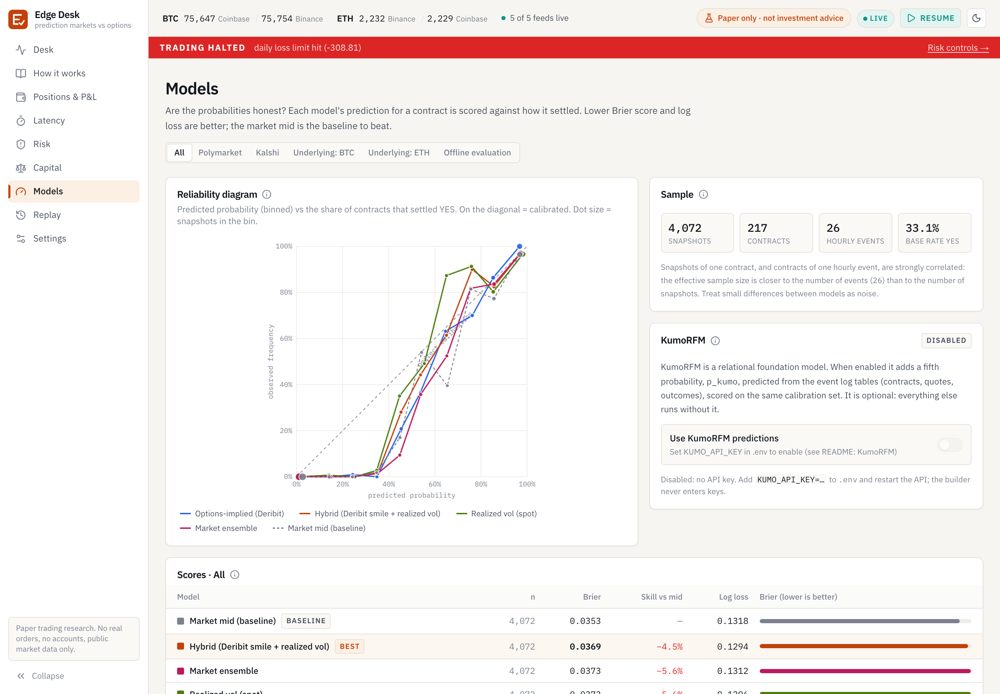 **Models**: calibration of each model against the market price on resolved contracts, per venue and underlying. |

<p>
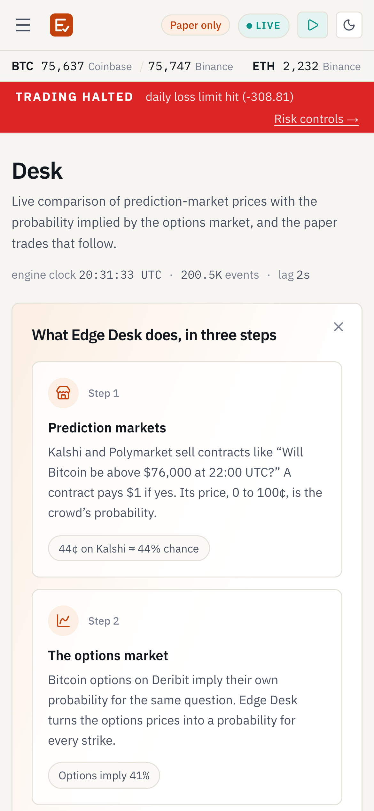
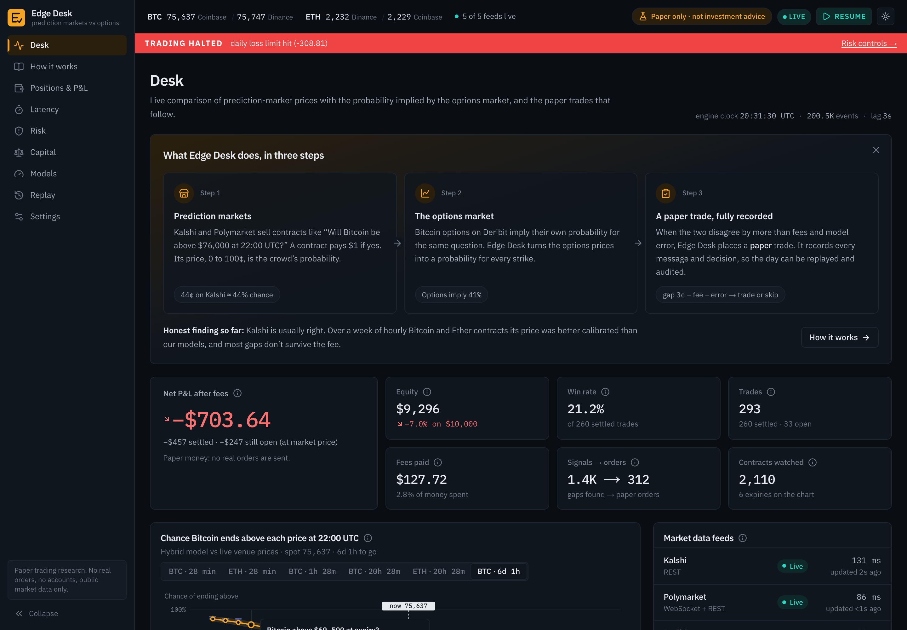
</p>

More: [capital tools (Kelly, joint allocation, risk of ruin)](docs/screenshots/capital.png) · [replay with digest](docs/screenshots/replay.png) · [settings](docs/screenshots/settings.png) · [latency, dark](docs/screenshots/latency-dark.png)

## How it works

1. **Record.** A recorder polls the public REST endpoints of Kalshi, Polymarket (Gamma + CLOB), Deribit, Coinbase and Binance and subscribes to their public WebSockets where they exist (Polymarket order books, Deribit index, Coinbase and Binance tickers). Every message is appended to a log with a global sequence number, the venue's timestamp and our receive timestamp. Polite per-host rate limits, backoff on 429/5xx, runs under `caffeinate` with a restart supervisor.
2. **Normalize.** Venue adapters turn raw messages into one convention: a YES order book per contract (Kalshi's "NO bids" become YES asks), contract definitions with their settlement reference, spot, the Deribit chain, outcomes.
3. **Guard.** Nothing reaches state without passing the ingest guard: malformed, duplicate, out-of-order, clock-skewed and delayed messages are dropped and logged, and a feed that misbehaves is marked unhealthy until it sends clean data again.
4. **Price.** For every contract: the options-implied probability from the Deribit smile (`P(S_T > K) = -dC/dK`, Breeden-Litzenberger), a realized-vol model from spot, a **hybrid** that uses the Deribit smile but leans on realized vol below the front expiry, and a market ensemble (logit pooling with the other venue's price). Each comes with an error band.
5. **Decide.** Trade only if `fair - price - fee - band >= min edge`. Size with fractional Kelly on the conservative probability, capped per market, per expiry, per underlying.
6. **Check.** 15 pre-trade risk checks (stale data, feed health, price band, exposure caps, daily loss...) on every order request; the full result is logged whether accepted or not.
7. **Execute on paper.** Orders reach the simulated venue after the measured one-way latency and fill against the recorded book *at arrival*, with a depth haircut, the venue's published fee formula, partial fills and an explicit order state machine.
8. **Reconcile.** A double-entry ledger and an independent fold over fills are compared after every fill and settlement; any break halts trading.

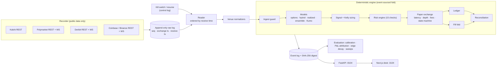

**One engine, two drivers.** The live desk is literally a replay that keeps going: it folds the recorder's log as it is written (with a 2-second reorder buffer), so any live decision can be reproduced bit-for-bit later. Operator actions (kill switch, resume) are written to the log too, stamped at the engine's event time, so a replay reproduces them exactly.

## Results

Full report: [`eval/report.md`](eval/report.md) (generated by `uv run python -m edgedesk.eval.report --decay --sweep`). The protocol was fixed before looking: the headline run uses the default configuration; tuning is only allowed on the first half of the data and is judged on the second.

**1. Is the model right more often than the market?** Mostly no. Calibration on resolved contracts:

| | contracts | market mid | options-implied | hybrid | realized vol | ensemble |
|---|---|---|---|---|---|---|
| Live, Kalshi | 79 | **0.0681** | 0.0751 | 0.0735 | 0.0752 | 0.0758 |
| Live, Polymarket | 127 | 0.0131 | 0.0120 | 0.0121 | 0.0116 | **0.0112** |
| History, Kalshi hourly (week) | 2,802 | **0.1032** | 0.1147 (DVOL) | 0.1081 (blend) | 0.1070 | |

Brier scores, lower is better. Over the week, Kalshi priced Bitcoin at about 32% annualised volatility for the next hour, while both the options market (DVOL 39%) and recent realized volatility (40%) said more, and Kalshi was right. Deribit's shortest option expires at 08:00 UTC the next day, so its implied volatility is a poor guide to the next 30 minutes; the hybrid model fixes part of that. Polymarket's thinner hourly books are where the models do beat the price, but on 24 expiries that is a hint, not a result.

**2. Does trading the gap make money after costs?** Not here. On the live recording the default strategy lost $645 after fees. The attribution says why: the model saw +$1,020 of edge at decision time, slippage and fees took $193, and outcomes came in $1,472 below what the model expected. In other words the "edge" was model error. Same data, other models: options-only -$1,263 (65 trades), ensemble -$174 (98 trades), resting maker orders -$363 (18 fills). The week of history agrees with a much bigger sample: every model and threshold lost 2.4 to 4.3 cents per contract after the Kalshi fee.

**3. Does speed matter?** Not for this strategy. Re-running the first 4.5 hours with 100 ms to 5 s of extra latency moves the result by tens of dollars, within noise; only at 10-60 s do fewer orders fill (and losses shrink because fewer trades happen). With no positive edge, there is nothing for latency to decay.

**4. Does tuning help?** It overfits on cue (27 combinations of model, minimum edge and safety margin, on the first 4.5 hours). The best parameters on the first half made +$1,343 in-sample and -$441 out-of-sample; the untouched default made +$343 and -$570.

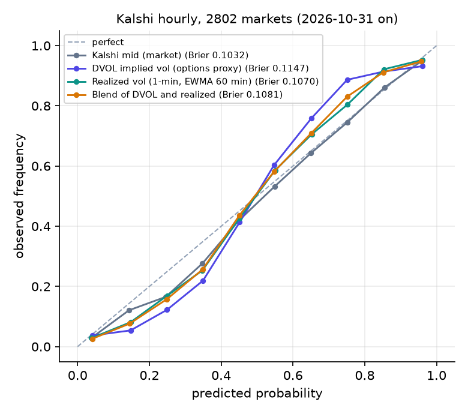

**Caveats.** One day of live data in one market regime; calibration snapshots of the same contract are correlated (read the contract and expiry counts). The recorder lost about an hour in total, mostly while the Mac was asleep after 18:33 UTC (gaps listed in the report). Fills are simulated against recorded books with a 50% depth haircut; Kalshi books are REST snapshots every 10-15 s because its WebSocket needs an account. Settlement references differ from the spot proxies used (Kalshi: CF BRTI 60-second average vs Coinbase; Polymarket: Binance 1-hour close). The historical study uses DVOL and 1-minute top-of-book candles, not full order books.


## Reliability, in detail

- **Event-sourced core.** Market data, model outputs, signals, risk decisions, order transitions, fills, settlements, halts and reconciliations are all events with a monotonic sequence number. State is a fold over them.
- **Deterministic replay.** The log carries a rolling SHA-256 over every event. Two replays of the same data with the same configuration give the same digest; a test checks this across separate processes with different hash seeds. Wall-clock timings (per-hop CPU latency) are measured on a side channel that never enters the log.
- **Order state machine** (`new → acked → partially filled → filled | cancelled | expired`, or `rejected`), with idempotency keys: re-sending the same key never creates a second order. Any illegal transition halts trading.
- **Fill simulator.** Orders arrive at decision time plus measured latency and walk the recorded book at that instant; a 50% depth haircut, liquidity we took stays consumed until the book updates, Kalshi fees rounded up to the cent per order, Polymarket fees to 5 decimals. Resting orders fill only when the market trades *through* their price, so queue position is never assumed.
- **Risk before every order**: halted? feeds healthy? book, spot and option chain fresh? price band, limit near fair, "too good to be true" edge, open orders, exposure per market / expiry / underlying / gross, daily loss. Kill switch in the UI and API cancels open orders and blocks new ones; the daily loss limit triggers it automatically.
- **Reconciliation** of a double-entry ledger against an independent position fold after every fill and settlement.
- **Fault injection** tests: dropped messages, a 15-minute connection gap, duplicates, reordering, malformed payloads, bursts of venue 429s, clock skew and delayed delivery, alone and combined. The engine must recover or halt, never trade on a degraded feed, and always reconcile.

## Key design decisions

- **Crypto brackets first.** Hourly expiries give fast, honest feedback on the model, data is continuous and free, and Deribit gives an independent price for the same risk. Kalshi-vs-Polymarket on the same event is tracked too (the ensemble uses it), but the literature and my own numbers agree that naive cross-venue gaps rarely survive a 2-cent fee.
- **Probabilities, not prices.** Both venues are converted into one YES-book convention and every model outputs a probability with an error band. The band is subtracted from the edge and from the Kelly input, so the desk bets less where it knows less.
- **Taker by default, honest about queues.** Taking liquidity is simulable from recorded books; resting orders are offered as an option with a conservative trade-through rule rather than an optimistic queue model.
- **The live desk is a replay.** Building live and backtest as the same code path removes the most common source of backtest/live divergence, and makes every live decision auditable.
- **No LLM at runtime.** The system is numerical end to end. KumoRFM (a relational foundation model) is integrated as an optional, experimental probability model behind a setting and a key.

## KumoRFM (experimental, off by default)

The event log is turned into a two-table relational database (`markets` with outcomes, `snapshots` with prices and model probabilities over time) and a relational foundation model is asked `PREDICT markets.outcome = 1 FOR markets.cid IN (...)` at an anchor time, learning in context from contracts that already resolved, with no look-ahead. Its predictions are scored alongside the other models on the Models page.

Status in November 2026: Kumo AI was acquired by NVIDIA in June 2026; the old `kumorfm.ai` API now redirects to NVIDIA's docs, and the model is offered as **NVIDIA Kumo Relational** (hosted endpoint on build.nvidia.com, or a self-hosted NIM), with a new client package (`structured-data-models-client`). The integration supports the legacy `kumoai` SDK and the new client (`KUMO_BACKEND=kumoai|sdm`). It needs a key I did not create; without it the rest of the system runs unchanged and the Models page says how to enable it.

## What I'd build next

- A live Kalshi WebSocket feed (it needs an authenticated account, which this paper build deliberately does not have), so Kalshi books are as fresh as Polymarket's.
- Historical Deribit smiles (paid data) for a longer, full-fidelity backtest; today the long historical study uses DVOL as the options proxy.
- Intraday vol seasonality for sub-hour horizons, and the Fed-decision and S&P 500 pairings from the design doc.
- A live adapter behind the same order interface, if and when it is legal to use one.

## About

Built by **Costantino Zunino** ([LinkedIn](https://www.linkedin.com/in/costantinozunino)). I designed the system, the models and the evaluation protocol, and built it with Claude Code as an AI pair-programmer.

---

## Run it locally

Requirements: Python 3.12 with [`uv`](https://docs.astral.sh/uv/), Node 20+ with `pnpm`. No keys needed.

```bash
git clone <this repo> && cd edge-desk
./start.sh            # starts the recorder (public data), API on :8104 and UI on :3104
./start.sh --demo     # no network: the desk runs on a seeded synthetic market
scripts/recorder.sh status | stop
```

Evaluation:

```bash
cd backend
uv run python -m edgedesk.eval.report --decay --sweep   # eval/report.md, eval/results/*.json, eval/figures/
uv run python -m edgedesk.eval.backfill --days 7          # historical week of Kalshi hourly brackets
```

**Tests**

```bash
cd backend && uv run pytest                          # engine, models, fees, risk, faults, determinism, API
cd frontend && pnpm lint && pnpm typecheck
cd frontend && pnpm test:e2e                         # Playwright against the mock-mode UI (port 3124)
```

The UI also runs without a backend on fixture data generated from the synthetic market: `cd frontend && NEXT_PUBLIC_MOCK=1 pnpm dev`.

## License

MIT
