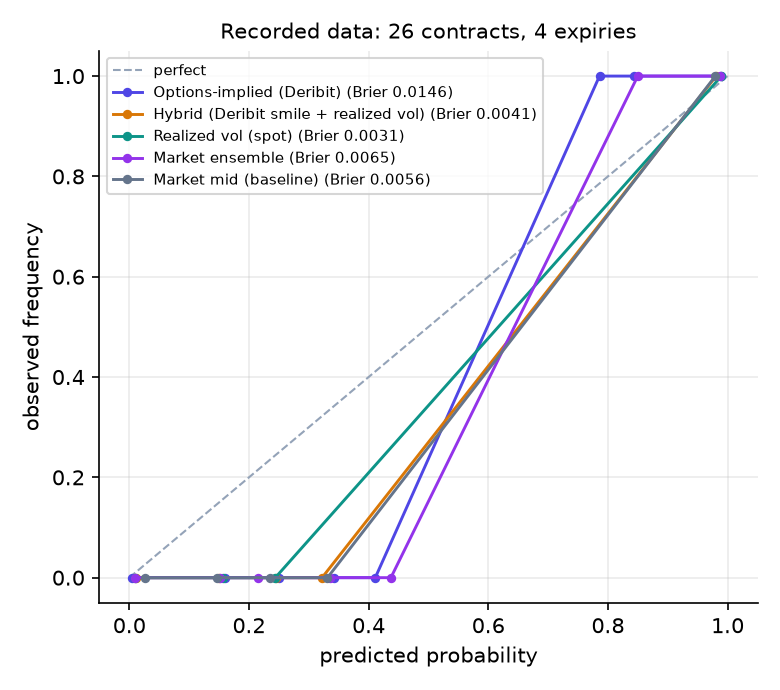
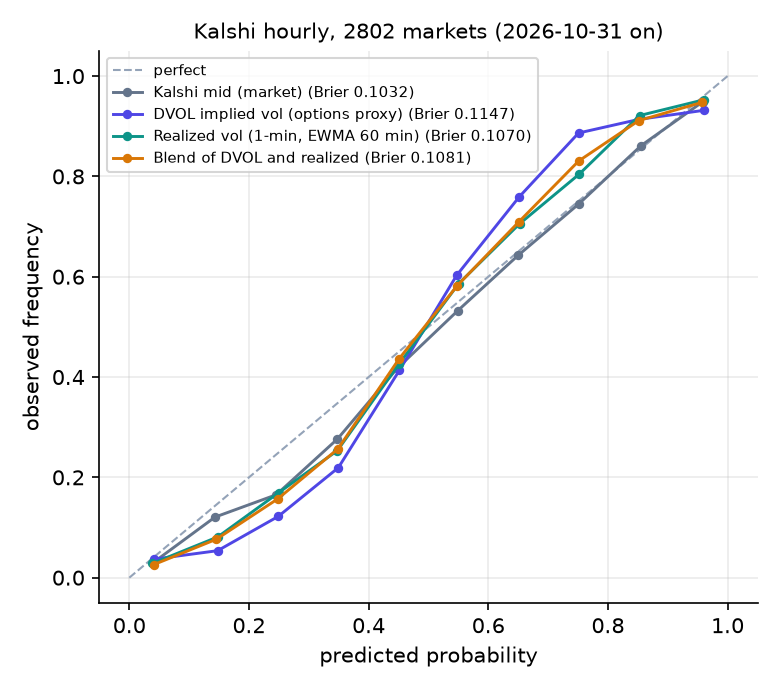
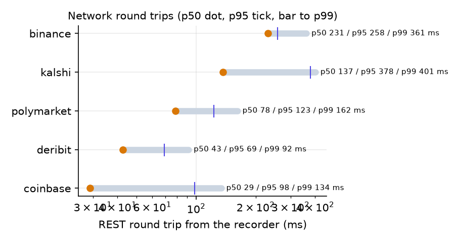
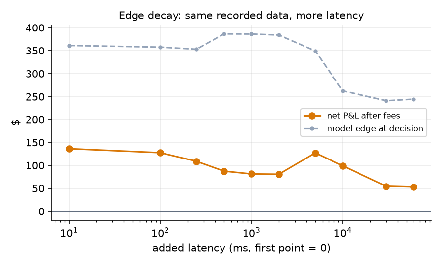

# Edge Desk: evaluation report

Generated 2026-11-07 15:30 UTC by `uv run python -m edgedesk.eval.report`. Paper trading only; not investment advice.

## Data

- Recorded period: **2026-11-07 14:21 UTC to 2026-11-07 15:30 UTC** (1.14 h), 51,232 raw messages, 714 contracts seen.
- Resolved contracts: Kalshi 242, Polymarket 36.
- Gaps longer than a minute: 2026-11-07 14:59 UTC to 2026-11-07 15:05 UTC (5.7 min).
- Determinism: two replays of the period gave the same digest (`189fc5690fc94728...`).

## Paper P&L (default configuration, not tuned)

Model `hybrid`, min edge 0.02 after fees and 1 error band, quarter Kelly on a $10,000 paper bankroll, one-way latency {'kalshi': 68.3, 'polymarket': 39.2} ms (half the measured median round trip).

| | value |
|---|---|
| Trades (orders with fills) | 73 (15 settled, 58 open) |
| Contracts bought / capital used | 4,946 / $2,685.01 |
| Gross settled P&L | +$114.42 |
| Fees paid | -$49.65 |
| **Net P&L after fees** (settled + open marked) | **+$136.24** |
| Return on capital used | 5.07% |
| Win rate (settled) | 53% |
| Max drawdown | -$23.43 |

Attribution of the total (per trade: model edge at decision, minus latency and slippage, minus fees, plus the difference between what happened and the model probability):

| edge at decision | latency | slippage | fees | outcome vs model |
|---|---|---|---|---|
| +$361.25 | +$0.00 | -$3.19 | -$49.65 | -$172.18 |

Same data, other traded models (default thresholds):

| model | trades | net after fees | fees |
|---|---|---|---|
| options | 65 | -$1,092.03 | -$65.07 |
| hybrid | 73 | +$136.24 | -$49.65 |
| ensemble | 98 | -$313.06 | -$66.23 |
| hybrid (maker orders) | 3 | +$63.50 | +$0.00 |

## Calibration on resolved contracts (recorded data)

238 snapshots, 26 contracts, 4 expiries, base rate 0.3529. Lower is better.

| model | Brier | log loss |
|---|---|---|
| Options-implied (Deribit) | 0.0146 | 0.0731 |
| Hybrid (Deribit smile + realized vol) | 0.0041 | 0.0308 |
| Realized vol (spot) | 0.0031 | 0.0230 |
| Market ensemble | 0.0065 | 0.0394 |
| Market mid (baseline) | 0.0056 | 0.0456 |

## Historical study: a week of Kalshi hourly brackets

2802 near-the-money markets in 327 hourly events (2026-10-31T14:00:00Z to 2026-11-07T14:00:00Z), sampled at 45, 30, 15, 5 minutes before expiry. 1-minute top of book, no depth, DVOL as the options proxy (no historical smile).

| horizon | n | Kalshi mid (market) | DVOL implied vol (options proxy) | Realized vol (1-min, EWMA 60 min) | Blend of DVOL and realized |
|---|---|---|---|---|---|
| all | 7803 | 0.1032 | 0.1147 | 0.1070 | 0.1081 |
| 45 min | 2689 | 0.1071 | 0.1190 | 0.1108 | 0.1121 |
| 30 min | 2388 | 0.1013 | 0.1129 | 0.1054 | 0.1065 |
| 15 min | 1793 | 0.0964 | 0.1071 | 0.1007 | 0.1012 |
| 5 min | 933 | 0.1100 | 0.1213 | 0.1120 | 0.1139 |
| BTC | 4545 | 0.1038 | 0.1142 | 0.1074 | 0.1082 |
| ETH | 3258 | 0.1024 | 0.1153 | 0.1063 | 0.1079 |

Brier scores. Threshold rule at the top of book after the Kalshi taker fee (1 contract per signal, decisions at 30 and 15 minutes, hold to settlement; 95% bootstrap interval on P&L per contract):

| model | threshold | trades | P&L / contract | 95% CI | hit rate |
|---|---|---|---|---|---|
| DVOL implied vol (options proxy) | 0.0 | 3524 | -0.0262 | [-0.0354, -0.0163] | 0.31 |
| DVOL implied vol (options proxy) | 0.02 | 2619 | -0.0292 | [-0.0411, -0.0180] | 0.24 |
| DVOL implied vol (options proxy) | 0.05 | 1807 | -0.0236 | [-0.0381, -0.0097] | 0.20 |
| Realized vol (1-min, EWMA 60 min) | 0.0 | 3235 | -0.0316 | [-0.0425, -0.0209] | 0.32 |
| Realized vol (1-min, EWMA 60 min) | 0.02 | 1791 | -0.0385 | [-0.0543, -0.0242] | 0.20 |
| Realized vol (1-min, EWMA 60 min) | 0.05 | 842 | -0.0430 | [-0.0658, -0.0208] | 0.16 |
| Blend of DVOL and realized | 0.0 | 3253 | -0.0276 | [-0.0382, -0.0171] | 0.28 |
| Blend of DVOL and realized | 0.02 | 2086 | -0.0386 | [-0.0518, -0.0251] | 0.20 |
| Blend of DVOL and realized | 0.05 | 1066 | -0.0354 | [-0.0553, -0.0150] | 0.20 |

Mean DVOL vs mean 1-minute realized vol: {'BTC': {'dvol_mean': 0.3941, 'rv_mean': 0.3992}, 'ETH': {'dvol_mean': 0.5345, 'rv_mean': 0.5074}}. Median vol implied by Kalshi mids: {'BTC': 0.3199, 'ETH': 0.397}.

## Latency

| source | n | p50 ms | p95 ms | p99 ms |
|---|---|---|---|---|
| binance REST round trip | 1906 | 231 | 258 | 361 |
| coinbase REST round trip | 1892 | 29 | 98 | 134 |
| deribit REST round trip | 1754 | 43 | 69 | 92 |
| kalshi REST round trip | 9143 | 137 | 378 | 401 |
| polymarket REST round trip | 741 | 78 | 123 | 162 |
| coinbase trade (ws) (receive minus exchange stamp) | 2020 | 33 | 42 | 86 |
| deribit index (ws) (receive minus exchange stamp) | 3485 | -9 | 103 | 660 |
| polymarket book (ws) (receive minus exchange stamp) | 29784 | -11 | 6 | 203 |

Internal hot path per message (µs): guard p50 2.8 / p99 6.2, model p50 13.9 / p99 28.8, signal p50 5.0 / p99 8.6, risk p50 20.7 / p99 35.6, order p50 7.5 / p99 16.8

## Edge decay

| added latency | trades | net after fees | model edge at decision | latency cost |
|---|---|---|---|---|
| 0 ms | 73 | +$136.24 | +$361.25 | +$0.00 |
| 100 ms | 72 | +$127.55 | +$357.66 | +$0.00 |
| 250 ms | 66 | +$108.80 | +$353.07 | +$0.05 |
| 500 ms | 68 | +$87.48 | +$386.42 | +$0.09 |
| 1,000 ms | 68 | +$81.35 | +$386.12 | +$0.20 |
| 2,000 ms | 66 | +$80.72 | +$383.94 | +$0.16 |
| 5,000 ms | 61 | +$127.14 | +$349.43 | +$1.46 |
| 10,000 ms | 55 | +$99.02 | +$262.56 | -$20.04 |
| 30,000 ms | 46 | +$54.50 | +$241.15 | -$16.84 |
| 60,000 ms | 41 | +$52.98 | +$244.55 | -$16.79 |

## Parameter sweep with out-of-sample check

Chosen on the first half (before 2026-11-07 14:55 UTC), judged on the second half.

| | model | min edge | bands | train net | test net |
|---|---|---|---|---|---|
| best in-sample | hybrid | 0.04 | 2.0 | +$98.18 | -$9.88 |
| default | hybrid | 0.02 | 1.0 | +$66.68 | -$0.86 |

## Risk

- 495 pre-trade risk decisions, 109 reconciliations (all clean), 123 input messages rejected by the ingest guard.
- Halts: none.
- Risk of ruin (bootstrap of 73 trade returns over 500 trades, ruin = -50%): 0.0%; median final equity x1.0959. Assumes independent trades: optimistic.

## Caveats

- A short recording window: hours to days, one market regime. Calibration snapshots of the same contract are correlated; read the contract and expiry counts, not the snapshot count.
- Fills are simulated against recorded books (REST snapshots every 10-15 s on Kalshi, WebSocket on Polymarket) with a 50% depth haircut; we never know our true queue position or market impact.
- Kalshi settles on the CF Benchmarks BRTI 60-second average; Coinbase spot is used as its proxy. Polymarket settles on the Binance BTC/USDT 1-hour close; Binance spot is used.
- Deribit's shortest listed expiry is the next 08:00 UTC; anything shorter is extrapolated (options model) or blended with realized vol (hybrid).
